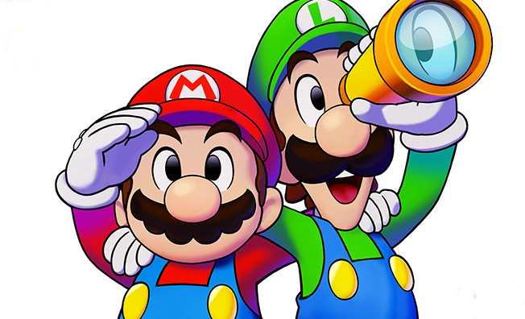
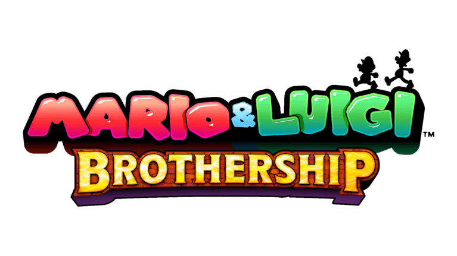

# meu segundo projeto com css
## tema escolhido Mario & Luigi: Brothership
## descrição
um site de mario&Luigi: Brothership explicando sua lore, mecânicas,desafios e etc...
## estruturas do projeto
* html
* head
* body
* div
* section
* main
* footer
* a 
* span
* header

## imagem do projeto

## linguagens usadas
html e css